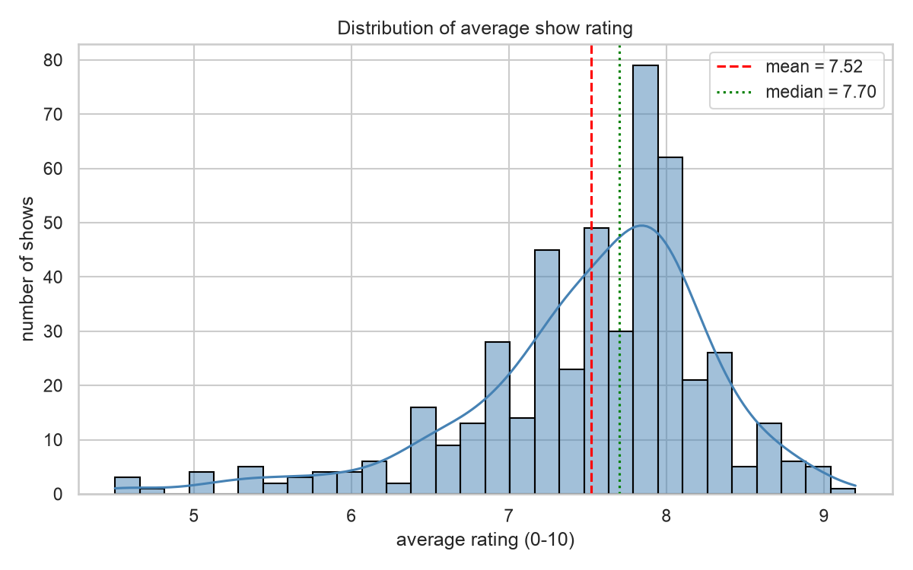
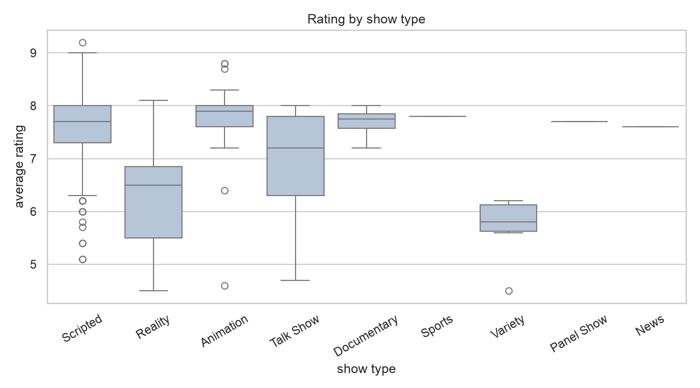
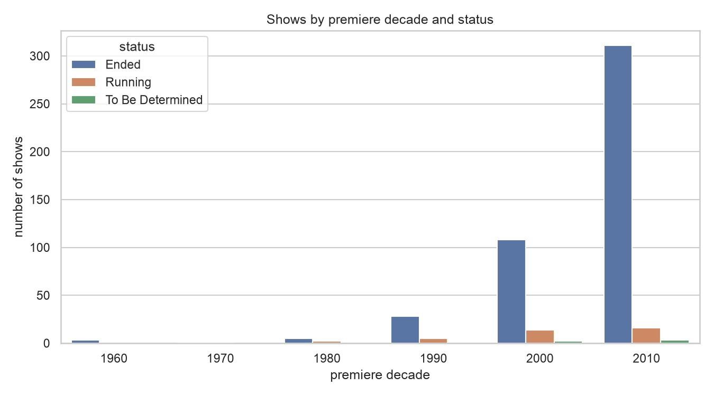
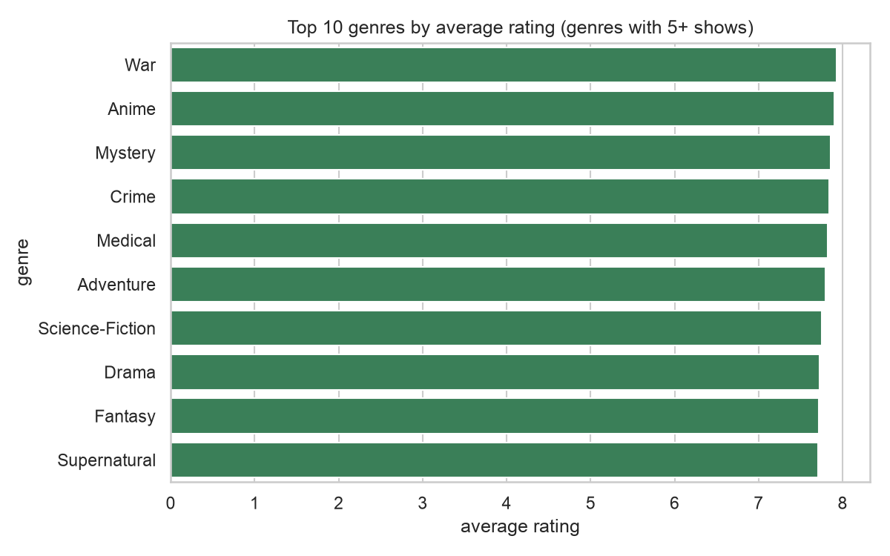

# Data collection and preparation SIS 2

**Author**: Baibolov Sultanmakhmut

## Project overview

An end-to-end data pipeline built on the public [TVmaze API](https://www.tvmaze.com/api):


## Requirements

- Python 3.10 or newer
- Docker Desktop (or Docker Engine with the Compose plugin) for the Kafka broker
- Internet access (for the TVmaze API and for downloading the Kafka image)
- Optional: the `sqlite3` command-line tool for manual database checks

## Installation

```bash
python3 -m venv .venv
source .venv/bin/activate
pip install -r requirements.txt
```

## Configuration

Install `.env` file from teams attachments and store it in project root directory.

## Kafka broker setup and startup

The broker runs in Docker: `docker-compose.yml`.

Start broker:
```bash
docker compose up -d
docker compose ps
```

Stop the broker when finished:
```bash
docker compose down
```

### Topic configuration

| Setting | Value |
|---|---|
| Topic name | `tvmaze_shows` |
| Partitions | 1 (keeps message order) |
| Replication factor | 1 (single broker) |
| Message format | JSON (UTF-8), key = show id |

The producer deletes and re-creates the topic at the start of every run, so the topic only
contains the messages of the current run.

## Running the pipeline

```bash
python3 main.py
```

## Database generation and verification

`python3 main.py` creates `data/db.sqlite` (table `shows`, primary key `show_id`), loads the
cleaned data **twice** and prints:

- the number of rows inserted by each load,
- the idempotency check (row count and table content must be identical after the second load),
- processed records vs stored records,
- SQL verification queries (row count, duplicate ids, average rating per type, top 5 rated shows, test records).


## Analysis results and figures

The analysis stage runs as the last step of `python3 main.py`. It prints dimensions, data types, descriptive statistics, grouped results and computed findings, and saves four figures to `figures/`.

### Main findings

- Mean rating `7.52`, median `7.70`; `4.2%` of shows have no rating.
- Best type by rating: Sports (`7.80`), worst: Variety (`5.68`).
- Most common type: Scripted.
- Decade with most shows: `2010`.
- Best genre: War (`7.93`).
- Correlation runtime vs rating: `0.10`.

### Figures

**1. Distribution of average show rating**




**2. Rating by show type**




**3. Shows by premiere decade and status**




**4. Top 10 genres by average rating**




## Expected outputs

With the default settings the console output should show approximately:

| Item | Expected |
|---|---|
| Records collected from the API | 500 |
| Messages published to Kafka | 500, failed: 0 |
| Messages consumed from Kafka | 500 |
| Test records appended in validation | 7, all detected as invalid |
| Valid / invalid records | about 500 valid; at least 7 invalid (test records plus any real invalid rows) |
| Records after cleaning | valid records minus duplicates |
| Records stored in SQLite | equal to the number after cleaning |
| Load 1 / Load 2 | all rows inserted / 0 rows inserted |


Generated files: `data/raw_api_response.json`, `data/raw_data.csv`, `data/valid_records.csv`, `data/invalid_records.csv`, `data/clean_data.csv`, `data/db.sqlite`, `figures/*.png`.

## Verifying a successful execution

1. `python3 main.py` finishes without errors.
2. All files of data directory listed above are generated.
